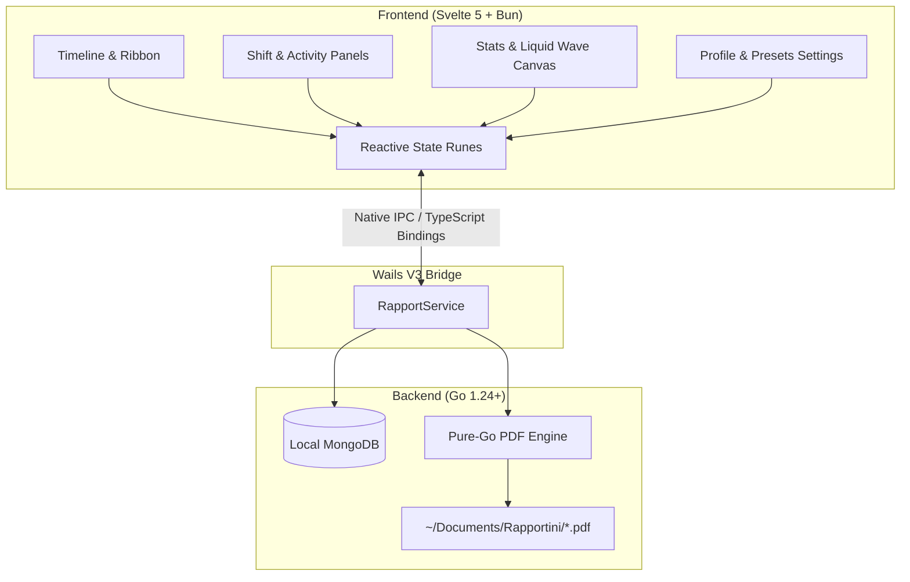

<div align="center">

# 💰 Rapportunchik (Рапортунчик)

### *The High-Performance Native Timesheet Logger & Italian "Rapportino" PDF Compiler*

[](https://v3.wails.io/)
[](https://svelte.dev/)
[](https://golang.org/)
[](https://bun.sh/)
[](https://www.mongodb.com/)
[](https://apple.com)
[](./LICENSE.md)

<p align="center">
  <b>Built for Italian Freelancers & "Collaboratori a Partita IVA"</b><br>
  Log daily hours, track monthly revenue milestones, and compile professional monthly Italian activity reports (<i>Rapportini</i>) in 1 click.
</p>

⭐ **If you find this project inspiring, please leave a star on GitHub!** ⭐

---

</div>

## 🌟 Overview

Working as a software consultant or contractor (*Collaboratore a Partita IVA*) in Italy requires submitting a formal **"Rapportino Mensile"** on the last working day of each month. 

Most freelancers are forced to wrestle with bloated subscription SaaS platforms, fragile Excel sheets, or clumsy manual PDF formatting.

**Rapportunchik** solves this with a privacy-first, blazing-fast native desktop application crafted with **Wails V3**, a pure **Go** backend, and a reactive **Svelte 5** frontend driven by **Bun**. Your data remains 100% on your machine in a local MongoDB database.

---

## ✨ Features at a Glance

### 📅 1. Full-Width Animated Timeline (`Main Page`)
- **Centered Day Ribbon**: Smooth horizontal scrolling ribbon highlighting the active date with an accent glow.
- **Adjacent Day Ticks**: Immediate context of previous and upcoming workdays with weekday names and numbers.
- **💰 Cash Bag Badges**: Worked days receive an embossed golden cash bag badge right on the timeline!
- **Fast Navigation**: One-click day switching, keyboard arrow support, and date picker integration.

### ⏱️ 2. Smart Pre-compiled Shift Presets
Pre-configured for standard hybrid schedules with automatic morning/afternoon split calculation:
- **Monday & Thursday (In Office / In Sede)**: `09:10 - 14:00` & `14:30 - 17:10` (7.5h)
- **Tuesday & Friday (Smart-working)**: `09:00 - 14:00` & `14:30 - 17:00` (7.5h)
- **Wednesday (Smart-working)**: `09:00 - 14:00` & `14:30 - 17:30` (8.0h)
- **Saturday & Sunday**: Non-working weekend presets.
- **Explicit "Giorno Lavorato" Toggle**: Mark days as officially worked to count toward monthly billing and timeline badges.
- **Activity & Objectives**: Clean markdown-friendly textarea for daily tasks and quick objective tags (e.g., `JIRA-123`, `Formazione`, `Bugfix`).
- **Debounced MongoDB Auto-Save**: Never lose a keystroke with non-blocking background persistence.

### 🌊 3. Interactive Liquid Tank & Milestone Physics (`Stats Page`)
- **60 FPS Double-Sine Wave Simulation**: Canvas-powered fluid animation with micro-bubble particle physics.
- **Milestone Fill Progress**: Slowly fills up based on all money accumulated across all worked months toward your total contract revenue target (e.g., **20,000 €**).
- **Monthly Revenue Progress Bar**: Instant feedback on monthly target vs. days worked.
- **All-Time Metrics**: Staggered readout of absolute total hours worked and total days logged since the beginning of collaboration (`16/10/2026`).
- **Historical Month Selector**: Bold interactive month header (`1° Mese`) opening a modal popup to inspect past performance.

### 📄 4. One-Click Italian Rapportino PDF Engine
- Pure Go PDF generator (built with `github.com/jung-kurt/gofpdf`) with full CP1252 accent support.
- Fully formatted Italian business document containing:
  - Header with Committente (*MGN Consulting*) & Collaborator fiscal data (P.IVA, C.F., IBAN, addresses).
  - Summary KPI cards: Giorni Lavorati, Totale Ore, Tariffa Giornaliera (160 €), Compenso Lordo.
  - Granular table of each worked day (Date, Luogo, Orari, Totale Ore, Obiettivo, Descrizione Attività).
  - Formal dual signature block (*Firma del Collaboratore* & *Firma del Committente per Approvazione*).
- Directly opens in macOS **Preview** and saves to `~/Documents/Rapportini/Rapportino_YYYY_MM.pdf`.

### ⚙️ 5. Customizable Profile & Preset Settings (`Profile Page`)
- Manage client details, fiscal codes, and billing information.
- Configure daily rate (e.g., `160 €`), overall target milestone (`20.000 €`), and contract start date.
- Customize weekly schedules and default locations for every day of the week.

### 🎨 6. Modern Dark Theme Aesthetics
- Crafted with electric indigo and deep slate color tokens:
  - Primary Indigo Accent: `hsl(234, 100%, 60%)`
  - Deep Navy Slate Surface: `hsl(234, 54%, 20%)`
  - Ice-Blue Glow: `hsl(234, 100%, 87%)`
- macOS hidden-inset translucent title bar with native window controls and sleek custom navigation tabs.

---

## 🛠️ Architecture & Tech Stack



| Layer | Technology | Details |
| :--- | :--- | :--- |
| **Desktop Framework** | [Wails V3](https://v3.wails.io/) | Lightweight native desktop shell with low memory footprint |
| **Backend** | [Go 1.24+](https://golang.org/) | Concurrent, high-performance Go backend with native macOS integration |
| **Frontend Framework** | [Svelte 5](https://svelte.dev/) | Driven by Svelte 5 Runes (`$state`, `$derived`, `$effect`) |
| **Package Manager** | [Bun](https://bun.sh/) | Blazing-fast JavaScript runtime and package manager |
| **Database** | [MongoDB Community](https://www.mongodb.com/) | Local-first document storage on `localhost:27017` |
| **PDF Generation** | [gofpdf](https://github.com/jung-kurt/gofpdf) | Zero-dependency pure-Go PDF compiler with table wrapping |
| **Packaging** | Native Apple Tools | Codesigned `.app` bundle and custom styled `.dmg` installer |

---

## 🚀 Quickstart & Development

### Prerequisites

Ensure you have the following installed on your system:
- **Go 1.24+**: `brew install go`
- **Bun**: `curl -fsSL https://bun.sh/install | bash`
- **Wails V3 CLI**: `go install github.com/wailsapp/wails/v3/cmd/wails3@latest`
- **MongoDB**: `brew tap mongodb/brew && brew install mongodb-community && brew services start mongodb-community`

### 1. Clone the Repository

```bash
git clone https://github.com/MyHouseIsBig/rapportini.git
cd rapportini/rapportunchik
```

### 2. Install Frontend Dependencies

```bash
cd frontend
bun install
cd ..
```

### 3. Run in Development Mode (Live Reload)

```bash
wails3 dev
```
*Hot reloading is enabled for both Svelte frontend and Go backend changes.*

### 4. Run Automated Backend Tests

```bash
go test -v .
```

### 5. Build Production Application & DMG Installer

```bash
# Build the .app bundle
wails3 task darwin:package

# Build the complete styled macOS DMG installer
wails3 task darwin:package:dmg
```
*The resulting binaries are output to `rapportunchik/bin/rapportunchik.app` and `rapportunchik/bin/rapportunchik.dmg`.*

---

## 📂 Repository Structure

```
rapportini/
├── .gitignore                    # Root repository ignore rules
├── LICENSE.md                    # MD-NCSL 1.0 License (Commercial rights reserved)
├── README.md                     # Project documentation & GitHub showcase
├── docs/                         # Architecture & design documentation
│   └── AI/                       # Implementation plans & walkthroughs
└── rapportunchik/                # Main Wails V3 application project
    ├── Taskfile.yml              # Task orchestration for build & packaging
    ├── main.go                   # Wails V3 application entrypoint
    ├── db.go                     # Local MongoDB repository & seeding
    ├── models.go                 # Data structures (Profile, DayPreset, WorkDayLog)
    ├── pdfservice.go             # Pure Go PDF compiler
    ├── rapportservice.go         # Wails service exposing backend methods
    ├── backend_test.go           # Automated tests for CRUD & PDF generation
    ├── build/                    # Native build resources & macOS assets
    │   ├── appicon.png           # Master 1024x1024 application icon
    │   ├── generate_assets.swift # Native Swift asset generator for ICNS & DMG
    │   └── darwin/               # Info.plist, icons.icns, DMG backgrounds
    └── frontend/                 # Svelte 5 single-page application
        ├── src/
        │   ├── lib/
        │   │   ├── components/   # Timeline, Schedule, Activity, LiquidContainer
        │   │   ├── views/        # MainView, StatsView, ProfileView
        │   │   └── state.svelte.ts # Reactive state management with Runes
        │   └── App.svelte        # Root Svelte component
        └── package.json          # Bun dependencies & build scripts
```

---

## 📄 License & Commercial Rights

This software is released under the **MD di MGNP Source-Available & Commercial Rights Reserved License (MD-NCSL 1.0)**.

- **Non-Commercial Use**: You are free to view, inspect, clone, study, and run the code locally for personal, educational, and evaluation purposes.
- **Commercial Rights Reserved**: **All commercial rights, monetization, SaaS deployment, white-labeling, and corporate timesheet management rights are strictly and exclusively reserved to MD di MGNP (Partita IVA: 04098520366).**
- For commercial licensing inquiries, please review [LICENSE.md](./LICENSE.md) or contact MD di MGNP.

---

<div align="center">

**Crafted with precision by MD di MGNP**

⭐ **Star Rapportunchik on GitHub if you enjoy modern desktop engineering!** ⭐

</div>
