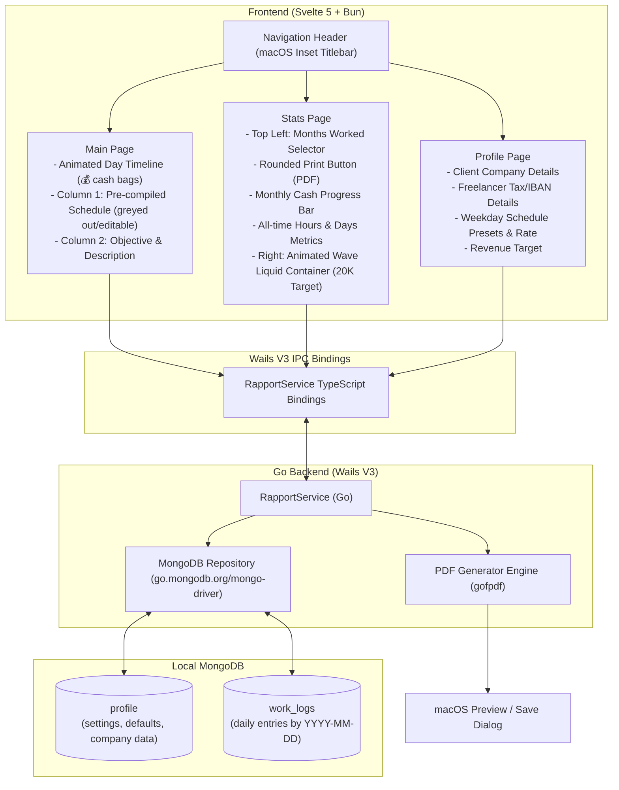

# Rapportunchik — Architecture & Implementation Plan

A modern, cross-platform macOS desktop application built with **Wails V3**, **Go backend**, **Svelte 5 frontend**, and **MongoDB** for managing, tracking, and generating monthly activity reports ("Rapportini") for Italian Partita IVA freelancing/collaboration.

---

## 1. Goal Description

The user is a software developer in Italy working under a "Collaborazione a Partita IVA". Every month, on the last working day, they are obligated to submit a **Rapportino** (a detailed monthly PDF activity sheet) containing:
- Worked hours for each worked day (start time, end time, split lunch break, total daily hours).
- The daily activity description.
- The objective/task worked on (e.g. Jira Issue key, "Formazione", refactoring).
- The workplace location ("In Sede / Office" or "Smart-working / Remoto").

### Contract & Work Defaults:
- **First Day of Work**: 16/10/2026.
- **Daily Rate**: 160.00 € / day.
- **Office Days**: Mondays & Thursdays, 09:10 – 14:00 and 14:30 – 17:10 (7h 30m).
- **Smart-working Days**:
  - **Tuesdays & Fridays**: 09:00 – 14:00 and 14:30 – 17:00 (7h 30m).
  - **Wednesdays**: 09:00 – 14:00 and 14:30 – 17:30 (8h 00m).
- **Weekends**: Saturdays & Sundays off by default.
- **Overall Revenue Target**: 20,000.00 €.

### Technology Stack:
- **Backend**: Go 1.26+, Wails V3 (`github.com/wailsapp/wails/v3 v3.0.0-beta.32`).
- **Database**: Local MongoDB (`mongodb://localhost:27017`), database `rapportunchik`.
- **Frontend**: Svelte 5 (runes `$state`, `$derived`, `$effect`), TypeScript, Vite, Bun packet manager.
- **Styling**: Tailored Dark Theme with requested accents:
  - `hsl(234, 100%, 60%)` (electric indigo primary)
  - `hsl(234, 54%, 20%)` (deep slate navy container surfaces)
  - `hsl(234, 100%, 87%)` (soft glowing ice-blue highlights)
- **PDF Engine**: Pure-Go PDF generator producing high-resolution, professional Italian corporate Rapportini with tables, company header, collaborator tax details, and signature fields.

---

## 2. User Review Required

> [!IMPORTANT]
> **Key Design Decisions for Confirmation**:
> 1. **Worked vs. Working Days**: A calendar day can be a "Working Day" (a scheduled weekday) and/or a "Worked Day" (actual work completed). To be counted as an actual **"Worked Day"**, it must be **explicitly marked as worked** (via the "Giorno Lavorato" toggle/button). Simply filling in an activity description or objective does NOT automatically mark it as worked. Only when explicitly marked as worked does its timeline tick display the cash bag (💰) icon, and only then does it contribute the daily rate (160 €) to the monthly and all-time revenue metrics.
> 2. **PDF Output Behavior**: Clicking the rounded **Print** button on the Stats page will compile the selected month's Rapportino into a `.pdf` file. By default, it will save it to `~/Documents/Rapportini/Rapportino_YYYY_MM.pdf` and immediately open it in native macOS Preview (via `open`), as well as offering a "Save As..." dialog option.
> 3. **MongoDB Connection**: MongoDB Community is verified running on `localhost:27017`. The app will connect automatically on startup and self-initialize the collections `profile` and `work_logs`.

---

## 3. Open Questions

> [!NOTE]
> Please review the proposed default data for the Client Company and your Collaborator profile (you can adjust all of these anytime from the **Profile Page**):
> - **Client Company**: Pre-filled with "MGN Consulting" (user can customize address, P.IVA, Codice Fiscale, contact email).
> - **Collaborator Data**: Pre-filled with customizable fields for Full Name, Partita IVA, Codice Fiscale, and IBAN for payment.

---

## 4. System Architecture & Workflow



---

## 5. Detailed Data Models & Specifications

### 5.1 MongoDB Models

#### `Profile` Collection (Single document `_id: "default"`)
```go
type Profile struct {
    ID                   string             `bson:"_id" json:"id"`
    ClientCompanyName    string             `bson:"clientCompanyName" json:"clientCompanyName"`
    ClientAddress        string             `bson:"clientAddress" json:"clientAddress"`
    ClientPIVA           string             `bson:"clientPIVA" json:"clientPIVA"`
    ClientContact        string             `bson:"clientContact" json:"clientContact"`
    ContractorName       string             `bson:"contractorName" json:"contractorName"`
    ContractorPIVA       string             `bson:"contractorPIVA" json:"contractorPIVA"`
    ContractorCF         string             `bson:"contractorCF" json:"contractorCF"`
    ContractorAddress    string             `bson:"contractorAddress" json:"contractorAddress"`
    ContractorIBAN       string             `bson:"contractorIBAN" json:"contractorIBAN"`
    FirstDayOfWork       string             `bson:"firstDayOfWork" json:"firstDayOfWork"` // "2026-10-16"
    DailyRate            float64            `bson:"dailyRate" json:"dailyRate"`           // 160.0
    RevenueTarget        float64            `bson:"revenueTarget" json:"revenueTarget"`   // 20000.0
    WeekdayPresets       map[int]DayPreset  `bson:"weekdayPresets" json:"weekdayPresets"` // 0=Sun ... 6=Sat
}

type DayPreset struct {
    IsWorkingDay   bool    `bson:"isWorkingDay" json:"isWorkingDay"`
    WorkLocation   string  `bson:"workLocation" json:"workLocation"` // "In Sede" / "Smart-working"
    MorningStart   string  `bson:"morningStart" json:"morningStart"` // "09:10" or "09:00"
    MorningEnd     string  `bson:"morningEnd" json:"morningEnd"`     // "14:00"
    AfternoonStart string  `bson:"afternoonStart" json:"afternoonStart"` // "14:30"
    AfternoonEnd   string  `bson:"afternoonEnd" json:"afternoonEnd"` // "17:10", "17:00", or "17:30"
    TotalHours     float64 `bson:"totalHours" json:"totalHours"`     // 7.5 or 8.0 (Wed)
}
```

#### `WorkDayLog` Collection
```go
type WorkDayLog struct {
    Date           string    `bson:"_id" json:"date"`                     // "YYYY-MM-DD"
    Year           int       `bson:"year" json:"year"`
    Month          int       `bson:"month" json:"month"`
    Day            int       `bson:"day" json:"day"`
    IsWorkingDay   bool      `bson:"isWorkingDay" json:"isWorkingDay"`
    WorkLocation   string    `bson:"workLocation" json:"workLocation"`   // "In Sede" / "Smart-working"
    MorningStart   string    `bson:"morningStart" json:"morningStart"`
    MorningEnd     string    `bson:"morningEnd" json:"morningEnd"`
    AfternoonStart string    `bson:"afternoonStart" json:"afternoonStart"`
    AfternoonEnd   string    `bson:"afternoonEnd" json:"afternoonEnd"`
    TotalHours     float64   `bson:"totalHours" json:"totalHours"`
    Objective      string    `bson:"objective" json:"objective"`         // Jira Issue, "Formazione", etc.
    Description    string    `bson:"description" json:"description"`     // Daily task description
    IsWorked       bool      `bson:"isWorked" json:"isWorked"`           // Flag indicating day was worked
    UpdatedAt      time.Time `bson:"updatedAt" json:"updatedAt"`
}
```

#### `MonthSummary` & `OverallStats` View Models
```go
type MonthSummary struct {
    Year                   int           `json:"year"`
    Month                  int           `json:"month"`
    MonthName              string        `json:"monthName"` // e.g. "Ottobre 2026"
    MonthIndex             int           `json:"monthIndex"` // 1-based relative to start date
    TotalCalendarDays      int           `json:"totalCalendarDays"`
    ExpectedWorkingDays    int           `json:"expectedWorkingDays"`
    WorkedDays             int           `json:"workedDays"`
    ExpectedMonthlyRevenue float64       `json:"expectedMonthlyRevenue"` // expectedWorkingDays * dailyRate
    CurrentMonthlyRevenue  float64       `json:"currentMonthlyRevenue"`  // workedDays * dailyRate
    TotalHours             float64       `json:"totalHours"`
    Days                   []WorkDayLog  `json:"days"`
}

type OverallStats struct {
    MonthsWorkedCount   int     `json:"monthsWorkedCount"`   // Months active since 16/10/2026
    TotalHoursWorked    float64 `json:"totalHoursWorked"`    // Absolute total hours
    TotalDaysWorked     int     `json:"totalDaysWorked"`     // Absolute total worked days
    TotalMoneyEarned    float64 `json:"totalMoneyEarned"`    // TotalDaysWorked * dailyRate
    RevenueTarget       float64 `json:"revenueTarget"`       // 20000.0
    LiquidFillPercent   float64 `json:"liquidFillPercent"`   // (TotalMoneyEarned / RevenueTarget) * 100
}
```

---

## 6. Page-by-Page UI & Interaction Design

### 6.1 Theme & Design Tokens
```css
:root {
  --accent-primary: hsl(234, 100%, 60%);     /* Electric Blue/Indigo */
  --accent-surface: hsl(234, 54%, 20%);      /* Deep Slate Accent Container */
  --accent-highlight: hsl(234, 100%, 87%);    /* Pale Glow Highlight */
  --bg-app: #080a14;
  --bg-card: #0f1326;
  --bg-card-subtle: #151a36;
  --border-card: rgba(147, 168, 255, 0.16);
  --border-focus: hsl(234, 100%, 60%);
  --text-main: #f0f3ff;
  --text-muted: #838eb0;
  --text-dim: #50597a;
}
```

### 6.2 Page 1: Main Page (`MainView.svelte`)

#### Top: Full-Width Animated Timeline
- **Layout**: Horizontal ribbon with dynamic centering on the selected date.
- **Main Tick**: Current / selected day with prominent highlight, date number, day name (e.g. "LUN 19").
- **Sub-Ticks**: Nearby days (earlier and later) rendered as sleek ticks with day numbers.
- **Cash Bag Icon (💰)**: Days where `isWorked == true` display a golden/blue cash bag badge right on top of the tick.
- **Interactivity**: Clicking any tick smoothly glides the timeline and loads that day's data into the panels below. Left/Right arrow key navigation supported.

#### Bottom: Dual Vertical Sections (Divided by vertical separator)
- **Vertical Separator**: A sleek vertical dividing line with subtle accent glow (`--border-card`).
- **Left Column: Schedule & Working Place (Pre-compiled)**:
  - Pre-filled based on day of week:
    - Monday & Thursday: In Sede, 09:10 – 14:00 / 14:30 – 17:10 (7h 30m).
    - Tuesday & Friday: Smart-working, 09:00 – 14:00 / 14:30 – 17:00 (7h 30m).
    - Wednesday: Smart-working, 09:00 – 14:00 / 14:30 – 17:30 (8h 00m).
    - Saturday & Sunday: Non-working day.
  - **Visual styling**: Greyed out by default (`opacity: 0.7; background: rgba(...)`) to clearly indicate it is pre-compiled, with an interactive "Edit / Customize Day" toggle button that unlocks inputs for manual override.
  - Working Day switch (`Giorno Lavorativo`).
  - Workplace pill selector: `[ 🏢 In Sede ]` | `[ 🏠 Smart-working ]`.
  - Shift inputs: Morning Start/End, Afternoon Start/End, auto-calculated total hours.
  - **"Giorno Lavorato" (Mark as Worked)** explicit toggle button with 💰 icon: only when this button is toggled on is the day registered as a Worked Day, granting the 💰 cash bag badge on the timeline and counting towards cash and day metrics.
- **Right Column: Activity & Objective (Empty by default)**:
  - Input field for **Obiettivo**: Empty by default. Placeholder: *"Es. JIRA-1042, Formazione, Refactoring..."*
  - Textarea for **Descrizione Attività**: Empty by default. Multi-line, auto-expanding. Placeholder: *"Descrivi le attività svolte durante la giornata lavorativa..."*
  - Instant auto-save with a subtle "Saved to MongoDB" pulse indicator.

---

### 6.3 Page 2: Stats Page (`StatsView.svelte`)

Divided into **two vertical halves**:

#### Left Half (Metrics & Actions):
1. **Months Worked Selector** (Top Left):
   - Big bold numeral: e.g. **"Mese 1"** (or calculated months since 16/10/2026).
   - Hover effect with glow.
   - Clickable: Opens an elegant modal popup showing all elapsed/available months (e.g. "Ottobre 2026", "Novembre 2026", etc.) allowing instant switching of the active month context.
2. **Rounded Print Button**:
   - Prominent rounded pill button with SVG printer icon.
   - Triggers Go backend PDF generation for the currently selected month.
   - Shows a loading spinner and success notification with "Apri PDF" action.
3. **Monthly Cash Progress Bar**:
   - Represents progress towards the expected monthly return based on:
     $$\text{Progress} = \frac{\text{Worked Days} \times \text{Daily Rate}}{\text{Total Working Days in Month} \times \text{Daily Rate}}$$
   - Displays current cash earned this month vs expected month total (e.g. `€ 1.600,00 / € 3.520,00`).
   - Smooth animated gradient bar.
4. **All-Time Key Metrics (Stacked)**:
   - **Metric 1**: Absolute Total Hours Worked since start date (16/10/2026).
   - **Metric 2**: Absolute Total Days Worked since start date.

#### Right Half (Animated Liquid Wave Container):
- A stylized rounded vertical reservoir / container.
- **Wave Physics Engine**: Dual-sine wave SVG/Canvas animation with phase shifts, simulating realistic organic liquid motion.
- **Accents**: Liquid gradient transitioning from `hsl(234, 54%, 20%)` to `hsl(234, 100%, 60%)` with a floating surface crest highlighted in `hsl(234, 100%, 87%)` and gently floating bubbles.
- **Target Logic**:
  - Takes into consideration all money accumulated across all months worked to date.
  - Fills progressively up to the revenue target (default **20,000.00 €**).
  - Prominently displays the total accumulated revenue, target, and completion percentage (e.g. `14.4% • € 2.880 / € 20.000`).

---

### 6.4 Page 3: Profile Page (`ProfileView.svelte`)

A dashboard for configuring all company data and schedule defaults:
1. **Dati Committente (Client Company)**:
   - Ragione Sociale: `MGN Consulting` (modifiable)
   - Sede Legale / Indirizzo
   - Partita IVA / Codice Fiscale
   - Referente / Email
2. **Dati Collaboratore (Partita IVA)**:
   - Nome e Cognome
   - Partita IVA
   - Codice Fiscale
   - Indirizzo di Fatturazione
   - Coordinate Bancarie (IBAN)
3. **Parametri Contrattuali**:
   - Data Inizio Collaborazione: `16/10/2026`
   - Tariffa Giornaliera (Daily Rate): `160,00 €`
   - Obiettivo Fatturato Complessivo (Liquid Target): `20.000,00 €`
4. **Configurazione Orari Predefiniti per Giorno della Settimana**:
   - Tabular or card layout for Mon, Tue, Wed, Thu, Fri, Sat, Sun.
   - Allows fine-tuning the default place (Sede vs Smart-working), shift 1 (start/end), shift 2 (start/end), and active working day status.
5. **MongoDB Sync**:
   - "Salva Modifiche" button with visual feedback and live recalculation across the app.

---

### 6.5 Italian Rapportino PDF Generation Spec

The PDF generated for the selected month will adhere to Italian professional consulting standards:
- **Header**:
  - Left: Collaborator Info (Nome, P.IVA, CF, Indirizzo).
  - Right: Committente Info (MGN Consulting, P.IVA, Indirizzo).
- **Title**:
  - `RAPPORTINO MENSILE ATTIVITÀ — OTTOBRE 2026`
- **Summary Box**:
  - Giorni Lavorati: `X` | Ore Totali: `Y` | Tariffa Giornaliera: `160,00 €` | Totale Compenso: `Z €`
- **Detailed Table**:
  - Headers: `Giorno` | `Data` | `Luogo` | `Fasce Orarie` | `Ore` | `Obiettivo / Task` | `Descrizione Attività`
  - Alternating subtle rows for readability.
- **Footer**:
  - Date and place of generation.
  - Two signature columns:
    - *Firma del Collaboratore*
    - *Firma del Committente per Approvazione*

---

## 7. Proposed Code Changes & Implementation Steps

Grouped by component layer:

### Component 1: Go Backend Dependencies & MongoDB Layer
#### [MODIFY] `rapportunchik/go.mod`
Add MongoDB driver (`go.mongodb.org/mongo-driver/v2`) and pure-Go PDF library (`github.com/jung-kurt/gofpdf`).

#### [NEW] `rapportunchik/db.go`
- Connection singleton connecting to `mongodb://localhost:27017` with database `rapportunchik`.
- Ping verification, collection helpers, auto-indexes on `date`.
- Default profile seed on initial run if empty.

#### [NEW] `rapportunchik/models.go`
- Go structs for `Profile`, `DayPreset`, `WorkDayLog`, `MonthSummary`, `OverallStats`.

#### [NEW] `rapportunchik/pdfservice.go`
- PDF generator implementing `GenerateMonthRapportinoPDF(profile Profile, summary MonthSummary) (string, error)`.
- Saves PDF file to `~/Documents/Rapportini/` and returns the file path.
- Handles opening in macOS default PDF viewer.

#### [NEW] `rapportunchik/rapportservice.go`
- Wails Service exposing methods to frontend:
  - `GetProfile() (*Profile, error)`
  - `SaveProfile(p Profile) error`
  - `GetDayLog(dateStr string) (*WorkDayLog, error)`
  - `SaveDayLog(log WorkDayLog) error`
  - `GetMonthSummary(year int, month int) (*MonthSummary, error)`
  - `GetOverallStats() (*OverallStats, error)`
  - `PrintRapportino(year int, month int) (string, error)`
  - `OpenFile(path string) error`

#### [MODIFY] `rapportunchik/main.go`
- Replace boilerplate `GreetService` with `RapportService`.
- Configure macOS window with hidden inset titlebar, translucent backdrop, minimum dimensions (1100 x 720).

---

### Component 2: Frontend Layout, State & Navigation
#### [MODIFY] `rapportunchik/frontend/package.json`
- Install any needed frontend utilities (e.g. `lucide-svelte` for clean modern icons).

#### [NEW] `rapportunchik/frontend/src/lib/types.ts`
- TypeScript definitions mirroring backend models.

#### [NEW] `rapportunchik/frontend/src/lib/state.svelte.ts`
- Reactive Svelte 5 state store managing:
  - Active tab (`'main' | 'stats' | 'profile'`)
  - Currently selected date and month
  - Cached day logs and month summary
  - Profile and overall stats

#### [NEW] `rapportunchik/frontend/src/lib/components/Navbar.svelte`
- Inset macOS titlebar with drag region, window title, and active page tab pills.

#### [MODIFY] `rapportunchik/frontend/src/App.svelte`
- Main shell hosting Navbar, toast notifications, and conditional view rendering:
  - `MainView.svelte`
  - `StatsView.svelte`
  - `ProfileView.svelte`

---

### Component 3: Main Page Components
#### [NEW] `rapportunchik/frontend/src/lib/views/MainView.svelte`
- Main container hosting the Timeline and the two vertically separated sections.

#### [NEW] `rapportunchik/frontend/src/lib/components/Timeline.svelte`
- Horizontal scrolling day ribbon with main tick for selected day, minor ticks for surrounding days, and cash bag badges (💰) for worked days.

#### [NEW] `rapportunchik/frontend/src/lib/components/SchedulePanel.svelte`
- Left section with pre-compiled schedule (hours, smart-working vs office, working day toggle), greyed out with unlock toggle.

#### [NEW] `rapportunchik/frontend/src/lib/components/ActivityPanel.svelte`
- Right section with empty-by-default Objective and Description inputs with auto-save.

---

### Component 4: Stats Page Components
#### [NEW] `rapportunchik/frontend/src/lib/views/StatsView.svelte`
- Split 50/50 container for metrics and the liquid container.

#### [NEW] `rapportunchik/frontend/src/lib/components/MonthSelectorModal.svelte`
- Interactive modal / popup triggered by clicking the big months number.

#### [NEW] `rapportunchik/frontend/src/lib/components/LiquidContainer.svelte`
- Canvas / SVG animated liquid wave container with continuous organic waves, filling up to the 20K target.

---

### Component 5: Profile Page Components
#### [NEW] `rapportunchik/frontend/src/lib/views/ProfileView.svelte`
- Modern settings form for Committente, Collaboratore, schedule defaults, daily rate, and revenue target.

---

## 8. Verification Plan

### Automated Verification
1. **Backend Tests**:
   - `cd rapportunchik && go test ./...`
   - Verify MongoDB repository CRUD operations for `Profile` and `WorkDayLog`.
   - Verify calculation logic: monthly expected revenue, worked days revenue, and overall stats.
   - Verify PDF generator creates a valid, non-corrupted PDF file containing table rows.
2. **Frontend Type Check & Build**:
   - `cd rapportunchik/frontend && bun run check`
   - `cd rapportunchik/frontend && bun run build`
   - Verify zero TypeScript or Svelte compiler errors.
3. **Wails Binding Generation & Compilation**:
   - `cd rapportunchik && wails3 generate bindings -ts`
   - `cd rapportunchik && wails3 build DEV=true`

### Manual Verification
1. **Timeline Navigation**:
   - Click different day ticks on the timeline: verify selected day updates smoothly.
   - Verify cash bag icon (💰) appears when a day is marked as worked.
2. **Pre-compiled vs Activity Inputs**:
   - Verify Monday/Thursday defaults to Office (09:10-14:00, 14:30-17:10, 7.5h).
   - Verify Tuesday/Friday defaults to Smart-working (09:00-14:00, 14:30-17:00, 7.5h).
   - Verify Wednesday defaults to Smart-working (09:00-14:00, 14:30-17:30, 8.0h).
   - Verify inputs are greyed out by default and can be unlocked/edited.
   - Verify Objective and Description are empty by default and persist immediately to MongoDB.
3. **Stats & PDF Generation**:
   - Verify clicking the month number opens the popup to select months.
   - Verify the cash progress bar reflects worked days * 160 €.
   - Verify the total hours and total days metrics match the sum of logged entries.
   - Click the rounded **Print** button: verify the generated PDF opens in Preview and correctly lists all daily hours, descriptions, and objectives.
4. **Animated Liquid Container**:
   - Verify fluid wave motion runs smoothly at 60fps.
   - Verify liquid level visually corresponds to accumulated cash / 20,000 €.
5. **Profile Settings**:
   - Change daily rate or default hours in Profile, save, and verify stats and schedule update across the app.
