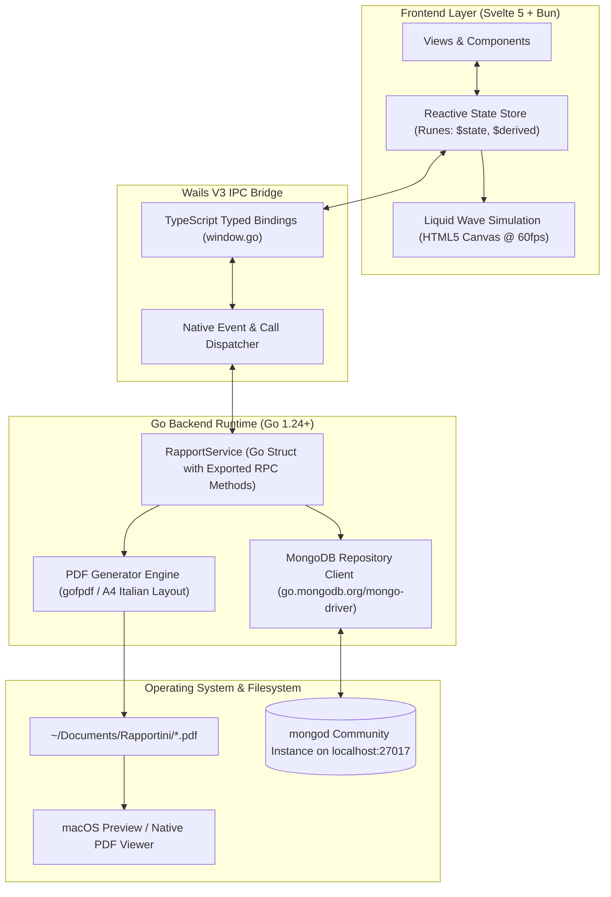

# Full Application Architecture & IPC Specifications

This document outlines the system architecture, inter-process communication (IPC) protocol, backend services, and frontend reactive state flow for **Rapportunchik**.

---

## 1. High-Level Architecture

Rapportunchik is built on an asynchronous, multi-threaded desktop architecture combining **Wails V3 (Go 1.24+)** for native system orchestration with **Svelte 5 (Bun + Vite)** for high-framerate, reactive user interface rendering, backed by **local-first MongoDB** persistence.



---

## 2. Visual Workflow & State Mapping

The UI reflects real-time synchronization between the Svelte 5 frontend and the Go backend services.

### 2.1 Main Timesheet & Shift Flow
When a user navigates dates via the animated timeline ribbon, the system queries the MongoDB repository via IPC (`GetWorkDayLog`). If no explicit record exists for that date, default presets (`DayPreset`) are retrieved dynamically based on the weekday.

<div align="center">
  
  <p><i>Figure 1: Main View showing a confirmed worked day with cash bag badge (💰) on the timeline and pre-compiled shift inputs.</i></p>
</div>

When a day is unconfirmed or falls on a weekend, the "Giorno Lavorato" toggle remains off, keeping the day excluded from monthly billing calculations:

<div align="center">
  
  <p><i>Figure 2: Main View displaying an unworked weekend day with unlocked editing capabilities.</i></p>
</div>

---

## 3. Wails V3 IPC Bridge Specifications

Wails V3 provides compile-time TypeScript binding generation. Every public method on `RapportService` is automatically exported to `frontend/bindings/changeme/rapportservice.ts`.

All IPC calls return standard JavaScript `Promise<T>` and execute asynchronously without blocking the UI thread.

### 3.1 IPC API Method Catalog

#### `GetProfile(): Promise<models.Profile>`
Retrieves collaborator fiscal data, client metadata, contract parameters, and weekly day presets.
- **Backend Handler**: `RapportService.GetProfile()`
- **Return Type**: `models.Profile` (JSON-serialized struct)
- **Error Handling**: Initializes and seeds default MongoDB document if database is unseeded.

#### `GetAllProfiles(): Promise<models.Profile[]>`
Retrieves all configured profiles stored in the MongoDB `profiles` collection for the top navigation bar profile switch dropdown.
- **Backend Handler**: `RapportService.GetAllProfiles()`
- **Return Type**: `models.Profile[]`
- **Fallback**: Returns the default profile (*MGN Consulting*) if unseeded.

#### `SaveProfile(profile: models.Profile): Promise<void>`
Persists modified fiscal, contract, or schedule preset settings.
- **Backend Handler**: `RapportService.SaveProfile(p models.Profile)`
- **Behavior**: Upserts the configuration record in the `profiles` collection and sets it as the active profile.

#### `SetActiveProfile(id: string): Promise<void>`
Sets the specified profile ID as the active working profile in both memory and persistent MongoDB configuration (`settings` collection).
- **Backend Handler**: `RapportService.SetActiveProfile(id string)`
- **Behavior**: Updates active profile pointer; subsequent calculations (monthly summary, daily rates, PDF generator) immediately use this profile.

#### `GetWorkDayLog(dateStr: string): Promise<models.WorkDayLog>`
Fetches the log for a specific date (`YYYY-MM-DD`).
- **Parameters**: `dateStr` (e.g., `"2026-10-19"`)
- **Behavior**: Checks `work_logs` collection. If absent, derives default hours and location from the weekday preset stored in `Profile`.

#### `SetWorkDayLog(log: models.WorkDayLog): Promise<void>`
Saves or updates daily activity logs with automatic total hour calculation.
- **Parameters**: `models.WorkDayLog` object
- **Behavior**: MongoDB upsert based on the unique `date` index. Debounced by 400ms on the frontend during typing.

#### `GetMonthSummary(year: number, month: number): Promise<models.MonthSummary>`
Calculates all worked days, total hours, and gross pay for the selected month.
- **Parameters**: `year` (int), `month` (1–12)
- **Aggregation**: Queries all logs between `YYYY-MM-01` and `YYYY-MM-LastDay` where `is_worked == true`.

#### `GetOverallStats(): Promise<models.OverallStats>`
Aggregates all-time performance metrics since collaboration inception (`2026-10-16`).
- **Return Fields**:
  - `TotalHours`: Absolute hours worked across all months.
  - `TotalDays`: Absolute number of confirmed worked days.
  - `TotalMoney`: Accumulated gross earnings (`TotalDays × DailyRate`).
  - `TargetRevenue`: Financial milestone target (default: `20,000.00 €`).
  - `TargetPercent`: Progress percentage towards the target milestone.
  - `MonthsWorked`: Count of active collaboration months.

<div align="center">
  
  <p><i>Figure 3: Stats View showing monthly expected progress, total hours/days counters, and real-time 60fps liquid tank wave simulation.</i></p>
</div>

#### `GeneratePDF(year: number, month: number): Promise<string>`
Triggers pure-Go PDF compilation of the monthly Italian *Rapportino*.
- **Parameters**: `year` (int), `month` (int)
- **Output**: Returns absolute path to the generated PDF (`~/Documents/Rapportini/Rapportino_YYYY_MM.pdf`).
- **System Action**: Invokes native `open` (macOS Preview) on completion.

---

## 4. Frontend State Flow (Svelte 5 Runes)

State management in `src/lib/state.svelte.ts` leverages modern **Svelte 5 Runes**:

```typescript
// Core reactive state container
export class AppState {
  activeTab = $state<'main' | 'stats' | 'profile'>('main');
  selectedDate = $state<string>('2026-10-19');
  profile = $state<Profile | null>(null);
  allProfiles = $state<Profile[]>([]);
  hasUnsavedProfileChanges = $state<boolean>(false);
  isUnsavedModalOpen = $state<boolean>(false);
  saveStatus = $state<'idle' | 'saving' | 'saved' | 'error'>('idle');
  ...
}
```

### 4.1 Profile Selector Modal & Navigation Guard
1. **Interactive Client Modal Popup**: Clicking the navbar profile pill opens `<ProfileSelectorModal />`. Users can switch between stored client profiles or choose "+ Aggiungi nuovo committente", which navigates directly to the Settings tab with a fresh pre-filled template.
2. **Immutable State & Reference Cloning**: `appState.saveProfile()` and `loadProfile()` clone profile objects (`JSON.parse(JSON.stringify(p))`) to eliminate memory reference aliasing, ensuring that editing fields in `ProfileView` reliably triggers the reactive `isDirty` derived rune even after immediate language switches.
3. **Dirty-State Button Activation**: The "Salva Modifiche" button remains disabled by default; it activates only when modifications exist and a client company name is entered.
4. **Instant Language Auto-Save**: Changing the active locale immediately persists the profile to MongoDB via `saveProfile()`.
5. **Tab & Profile Interception**: Navigating away from the Settings tab or switching profiles while unsaved edits exist invokes the navigation guard, presenting `<UnsavedChangesModal />` to let the user choose between staying or discarding edits. If discarding an unsaved new profile draft, the state safely reverts to the previous saved profile.

### 4.2 Unidirectional Event Loop
1. **User Interaction**: Day selected on Timeline ribbon or shift hours modified.
2. **Local Mutation**: `$state` values update immediately for zero input lag.
3. **Debounced Persistence**: Background timer triggers `RapportService.SetWorkDayLog(log)`.
4. **Broadcast & Metrics Sync**: On save completion, `overallStats` and `monthSummary` refresh reactively, updating the liquid tank level and progress bars.

---

## 5. Security & Isolation

- **Local-Only Communication**: Wails V3 IPC operates strictly over local inter-thread memory buffers; no exposed HTTP ports or external network attack surfaces.
- **Privacy Guarantee**: All timesheet entries, client tax IDs, and financial metrics stay confined to the local MongoDB database on `localhost:27017`.
