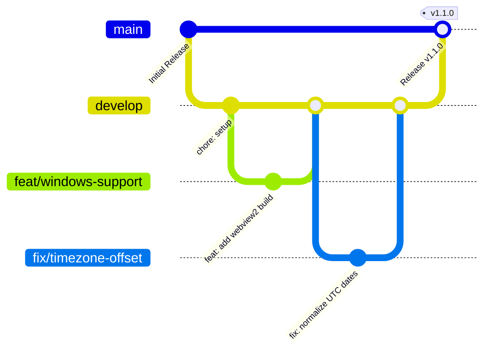

# Developer Guidelines & Contributing Code of Conduct

Welcome to the **Rapportunchik** developer community! This guide provides everything you need to know about contributing to the codebase, setting up your environment, adhering to code style standards, and complying with our Code of Conduct.

---

## 1. Code of Conduct

### Our Pledge
We are committed to providing a welcoming, inclusive, and harassment-free experience for everyone, regardless of age, body size, disability, ethnicity, gender identity and expression, level of experience, nationality, personal appearance, race, religion, or sexual identity and orientation.

### Our Standards
Examples of behavior that contributes to a positive environment:
- Using welcoming and inclusive language.
- Being respectful of differing viewpoints and experiences.
- Gracefully accepting constructive criticism.
- Focusing on what is best for the community and users.
- Showing empathy towards other community members.

Examples of unacceptable behavior:
- The use of sexualized language or imagery.
- Trolling, insulting or derogatory comments, and personal or political attacks.
- Public or private harassment.
- Publishing others' private information without explicit permission.

### Enforcement
Instances of abusive, harassing, or otherwise unacceptable behavior may be reported by contacting the project maintainers via GitHub. All complaints will be reviewed and investigated fairly.

---

## 2. Git & Branching Workflow

We adhere to a structured Git-Flow methodology:



### Branch Naming Conventions
- `feat/<short-description>`: New capabilities or views (e.g., `feat/english-locale`).
- `fix/<short-description>`: Bug fixes (e.g., `fix/liquid-canvas-resize`).
- `docs/<short-description>`: Documentation improvements (e.g., `docs/docker-recipes`).
- `refactor/<short-description>`: Code restructurings without behavior changes.

### Commit Messages (Conventional Commits)
Write commit messages in the imperative mood adhering to Conventional Commits:
```
<type>(<scope>): <short summary>

[optional body explaining context, tradeoffs, and rationale]

[optional footer(s)]
```
*Allowed types*: `feat`, `fix`, `docs`, `style`, `refactor`, `perf`, `test`, `chore`.

---

## 3. Local Development Setup

### System Prerequisites
1. **Go 1.24+**: `brew install go` (macOS) or download from [go.dev](https://go.dev).
2. **Bun 1.2+**: `curl -fsSL https://bun.sh/install | bash`
3. **Wails V3 CLI**:
   ```bash
   go install github.com/wailsapp/wails/v3/cmd/wails3@latest
   ```
4. **MongoDB Community**:
   ```bash
   brew tap mongodb/brew
   brew install mongodb-community
   brew services start mongodb-community
   ```

### Running Locally
```bash
# 1. Clone the repository
git clone https://github.com/MyHouseIsBig/rapportini.git
cd rapportini/rapportunchik

# 2. Install frontend packages
cd frontend && bun install && cd ..

# 3. Launch live development mode
wails3 dev
```

---

## 4. Coding Standards

### 4.1 Go Backend Standards
- **Formatting**: All Go files must be formatted with standard `gofmt` (`go fmt ./...`).
- **Dependencies**: Keep external dependencies minimal. Use standard library or vetted pure-Go packages where possible.
- **Error Handling**: Handle errors explicitly; do not swallow errors or leave unhandled errors without logging.
- **Models & Structs**: Ensure all struct fields exposed to the frontend carry both `json:"..."` and `bson:"..."` annotations.

```go
// Example model convention
type WorkDayLog struct {
    Date        string  `json:"date" bson:"date"`
    IsWorked    bool    `json:"is_worked" bson:"is_worked"`
    TotalHours  float64 `json:"total_hours" bson:"total_hours"`
}
```

### 4.2 Svelte 5 & TypeScript Standards
- **Svelte 5 Runes**: Always use Svelte 5 Runes (`$state`, `$derived`, `$effect`). Do not introduce legacy Svelte 3/4 stores (`writable`).
- **TypeScript**: Maintain strict typing without `any` overrides. Rely on models imported from `frontend/bindings/changeme`.
- **CSS Tokens & Design System**: Use the established dark theme tokens:
  - Primary Electric Indigo: `hsl(234, 100%, 60%)`
  - Deep Navy Slate Surface: `hsl(234, 54%, 20%)`
  - Ice-Blue Glow: `hsl(234, 100%, 87%)`
  - Background Base: `#080a14` to `#0d1124`

---

## 5. Testing & Validation

Before opening a pull request, run all verification suites:

```bash
# 1. Run backend unit & integration tests
cd rapportunchik
go test -v .

# 2. Run TypeScript type checks
cd frontend
bun run check

# 3. Test production packaging
cd ..
wails3 task darwin:package
```

---

## 6. Pull Request Process

1. Fork the repo and create your feature branch from `develop`.
2. Ensure automated tests pass and frontend builds cleanly.
3. Update relevant documentation in `docs/` or `README.md` if user-facing behavior changes.
4. Submit a Pull Request targeting the **`develop`** branch.
5. Provide a clear description of changes, motivation, and test steps in the PR description.
