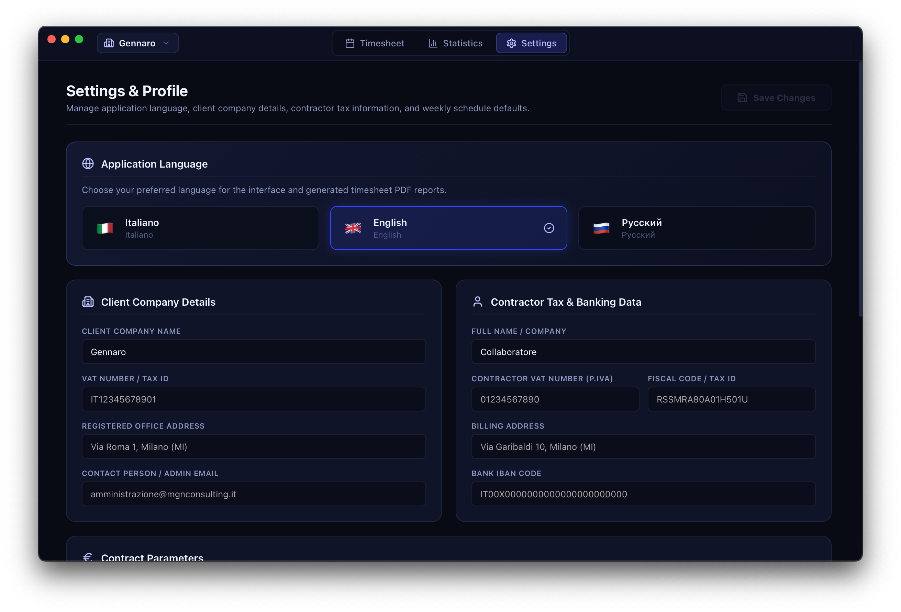
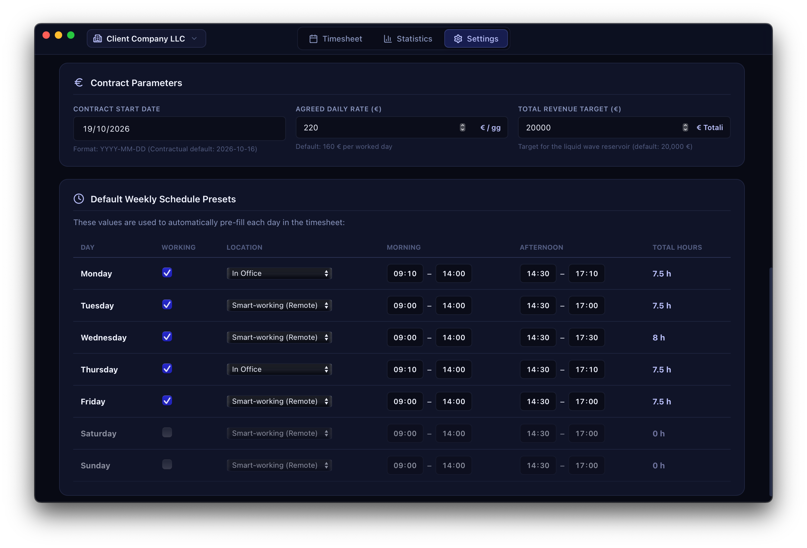

# MongoDB Schema & Data Export Recipes

This document provides a comprehensive reference for the **Rapportunchik** local MongoDB database schema, document models, indexes, and recipes for backup, restoration, and data export.

---

## 1. Database Architecture Overview

Rapportunchik is engineered with a **local-first, privacy-first** database topology. All data stays strictly on your local machine:

- **Host**: `localhost:27017`
- **Database Name**: `rapportunchik`
- **Driver**: Official MongoDB Go Driver (`go.mongodb.org/mongo-driver`)
- **Connection URI**: `mongodb://localhost:27017/?connectTimeoutMS=2000`

---

## 2. Collections & Document Schemas

The database consists of two core collections: `profiles` and `work_logs`.

### 2.1 The `profiles` Collection

Stores the client company information, collaborator tax credentials, contract parameters, and weekly schedule presets. Only a single configuration document is maintained.

<div align="center">
  
  <p><i>Figure 1: Profile View top half mapping Committente, Collaboratore, and Contract Parameters.</i></p>
</div>

#### JSON Schema Specification

```json
{
  "_id": { "$oid": "..." },
  "committente": {
    "ragione_sociale": "MGN Consulting",
    "partita_iva": "IT09876543210",
    "codice_fiscale": "09876543210",
    "indirizzo": "Via Roma 100, 20121 Milano (MI)",
    "email": "amministrazione@mgnconsulting.it"
  },
  "collaboratore": {
    "nome_cognome": "MD di MGNP",
    "partita_iva": "04098520366",
    "codice_fiscale": "PLNMXM98T16F205X",
    "indirizzo": "Via Modena 24, 41121 Modena (MO)",
    "iban": "IT60X0542811101000000123456"
  },
  "contratto": {
    "tariffa_giornaliera": 160.0,
    "data_inizio": "2026-10-16",
    "target_revenue": 20000.0
  },
  "presets": [
    {
      "day_of_week": 1,
      "name": "Lunedì",
      "location": "In Sede",
      "morning_start": "09:10",
      "morning_end": "14:00",
      "afternoon_start": "14:30",
      "afternoon_end": "17:10",
      "total_hours": 7.5,
      "is_working_day": true
    },
    ...
  ]
}
```

<div align="center">
  
  <p><i>Figure 2: Profile View bottom half showing the weekly shift presets table.</i></p>
</div>

---

### 2.2 The `work_logs` Collection

Stores daily activity logs, work locations, shifts, hours worked, objectives, and task descriptions, isolated per client profile.

#### JSON Schema Specification

```json
{
  "_id": "default_2026-10-19",
  "profileId": "default",
  "date": "2026-10-19",
  "year": 2026,
  "month": 10,
  "day": 19,
  "isWorked": true,
  "workLocation": "In Sede",
  "morningStart": "09:10",
  "morningEnd": "14:00",
  "afternoonStart": "14:30",
  "afternoonEnd": "17:10",
  "totalHours": 7.5,
  "objective": "JIRA-1042 Formazione Wails",
  "description": "Implemented Svelte 5 state management and connected MongoDB local driver.",
  "updatedAt": "2026-10-19T14:35:00Z"
}
```

### 2.3 Database Indexes

| Collection | Key | Type | Properties | Purpose |
| :--- | :--- | :--- | :--- | :--- |
| `work_logs` | `profileId`, `date` | Compound Index | `unique: true` | Scopes work logs per client profile & prevents duplicate daily entries |
| `work_logs` | `profileId`, `isWorked` | Compound Index | Standard | Accelerates monthly summary and overall stats aggregations per profile |
| `profiles` | `_id` | Single Field | `unique: true` | Primary key identifier for client profiles |
| `settings` | `_id` | Single Field | `unique: true` | Application runtime state (stores active profile pointer) |

---

## 3. Data Export & Backup Recipes

### 3.1 Full Database Binary Dump (`mongodump`)
Creates an exact binary backup of all collections:

```bash
mkdir -p ./backups
mongodump --db=rapportunchik --out=./backups/backup_$(date +%Y%m%d_%H%M%S)
```

### 3.2 Full Database Restoration (`mongorestore`)
Restores a previously exported backup:

```bash
mongorestore --db=rapportunchik ./backups/backup_20261019_153000/rapportunchik
```

### 3.3 Exporting Timesheet Logs to JSON (`mongoexport`)
Exports all daily logs into formatted JSON:

```bash
mongoexport \
  --db=rapportunchik \
  --collection=work_logs \
  --out=work_logs_export.json \
  --jsonArray \
  --pretty
```

### 3.4 Exporting to CSV (for Accountants & Excel)
Exports worked days directly into a spreadsheet-friendly CSV format:

```bash
mongoexport \
  --db=rapportunchik \
  --collection=work_logs \
  --type=csv \
  --fields=date,is_worked,location,morning_start,morning_end,afternoon_start,afternoon_end,total_hours,objective,description \
  --query='{"is_worked": true}' \
  --out=rapportino_worked_days.csv
```

### 3.5 Quick MongoDB Shell Inspection (`mongosh`)
```bash
mongosh rapportunchik --eval '
  print("Total Logged Entries:", db.work_logs.countDocuments());
  print("Confirmed Worked Days:", db.work_logs.countDocuments({ is_worked: true }));
  print("Profile Target:", db.profiles.findOne().contratto.target_revenue);
'
```
